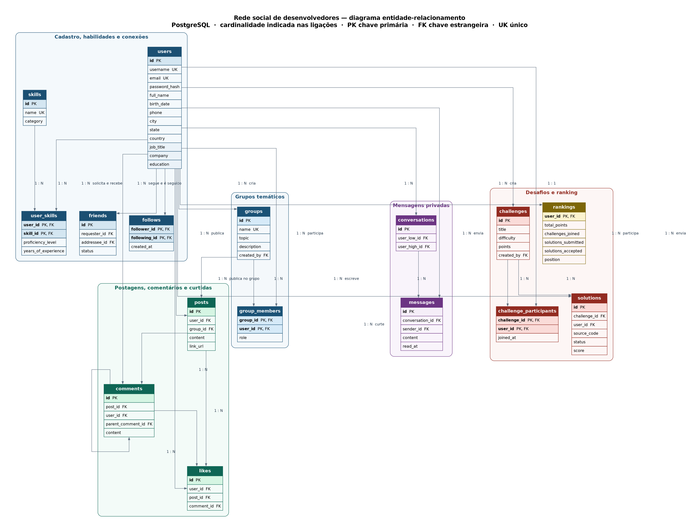

<div align="center">

# DevConnect

**Rede social para desenvolvedores: compartilhe conhecimento, crie conexões e converse com sua comunidade.**

[](#executar-localmente)
[](https://github.com/users/usrJosephC/projects/3)

[PRD](docs/PRD.md) · [Guia de entrega](docs/DELIVERY.md) · [Contrato da API](docs/API.md) · [Quadro do projeto](https://github.com/users/usrJosephC/projects/3)

</div>

---

## 📑 Navegação

- [Funcionalidades](#-o-que-tem-aqui)
- [Tecnologias](#-stack)
- [Design e acessibilidade](#-design-e-acessibilidade)
- [Fluxo da aplicação](#-fluxo-da-aplicação)
- [Execução local](#executar-localmente)
- [Como usar](#-como-usar)
- [Comandos e testes](#-scripts-úteis)
- [Observabilidade](#-observabilidade)
- [Banco e segurança](#-banco-e-segurança)
- [Diagrama e modelagem](#diagrama-entidade-relacionamento)
- [Estrutura](#estrutura-do-repositório)
- [Contribuição](#processo-obrigatório-de-desenvolvimento)
- [Equipe](#contribuidores)

## 🚀 O que tem aqui

- **Conta e sessão:** cadastro, login, restauração de sessão e logout.
- **Perfil técnico:** nome, apresentação, cidade, cargo, empresa, formação e habilidades.
- **Conexões:** busca por nome/usuário, pedidos de amizade, aceite, recusa, bloqueio e seguidores.
- **Comunidade:** publicações de texto e link, edição pelo autor, curtidas e comentários.
- **Chat privado com NoSQL:** conversa entre amizades aceitas, histórico persistido no MongoDB, paginação e proteção contra mensagens duplicadas.
- **Grupos:** criação, participação e publicações restritas aos membros.
- **Desafios e ranking:** inscrição, envio de código, avaliação pelo criador e pontuação automática.
- **Execução reproduzível:** aplicação, PostgreSQL e MongoDB iniciados pelo Docker Compose.
- **Qualidade automatizada:** testes unitários, integração com bancos reais, E2E e CI em PRs para `dev` e `main`.

O projeto nasceu da modelagem de uma rede social em PostgreSQL e evoluiu para a aplicação **DevConnect**. O material SQL original permanece documentado neste README. A entrega atual é local; não há um domínio público de produção configurado.

---

## 💻 Stack

[](https://nodejs.org/)
[](https://developer.mozilla.org/pt-BR/docs/Web/JavaScript)
[](https://expressjs.com/)
[](https://developer.mozilla.org/pt-BR/docs/Web/HTML)
[](https://developer.mozilla.org/pt-BR/docs/Web/CSS)
[](https://www.postgresql.org/)
[](https://www.mongodb.com/)
[](https://www.docker.com/)

| Camada | Tecnologias | Papel no projeto |
| --- | --- | --- |
| Interface | HTML, CSS e JavaScript com ES modules | Navegação, formulários, feed e chat responsivo; módulo de chat carregado sob demanda |
| API | Node.js 22 e Express 5 | Rotas JSON, autenticação, autorização e entrega dos arquivos estáticos |
| Dados relacionais | PostgreSQL 16 e `pg` | Usuários, sessões, amizades, publicações, grupos, desafios e ranking |
| Conversas | MongoDB 7 e driver oficial para Node.js | Coleções de conversas e mensagens, validators e índices |
| Segurança | `node:crypto`, Helmet e express-rate-limit | Hash scrypt, tokens de sessão, headers de segurança e limitação de requisições |
| Ambiente | Docker e Docker Compose | Aplicação e bancos em containers, healthchecks e volumes persistentes |

O script relacional original requer **PostgreSQL 14+**; o ambiente Compose usa **PostgreSQL 16**. As versões das dependências ficam em [package.json](package.json) e [package-lock.json](package-lock.json).

### Qualidade e observabilidade

[](https://biomejs.dev/)
[](https://playwright.dev/)
[](https://github.com/vinicastrolima/social-network-db/actions)
[](https://opentelemetry.io/)
[](https://about.codecov.io/)

- **Biome:** lint e formatação.
- **Node Test Runner:** testes unitários, contrato de arquitetura e integração.
- **Playwright:** testes E2E em navegador e evidências visuais.
- **c8 e Codecov:** cobertura LCOV e upload configurado no CI.
- **Knip e Commitlint:** análise de código/dependências não utilizados e validação do título do PR.
- **Stryker:** testes de mutação do domínio, com limite mínimo de 80%.
- **OpenTelemetry e prom-client:** spans HTTP com exportação opcional e métricas protegidas.

As badges identificam tecnologias e integrações; não representam aprovação automática ou serviços externos já provisionados.

---

## 🎨 Design e acessibilidade

O estilo visual fica em [public/style.css](public/style.css).

| Papel | Cor |
| --- | --- |
| Navegação | `#123E53` |
| Ação principal | `#096B80` |
| Fundo | `#EDF3F6` |
| Superfícies | `#FFFFFF` |
| Texto principal | `#183441` |
| Texto secundário | `#526976` |

A interface utiliza **Segoe UI**, com fallback para fontes do sistema, layouts adaptados ao celular, foco visível, rótulos nos formulários, mensagens de estado e skeletons. As transições são curtas e respeitam `prefers-reduced-motion`; a digitação e a chegada de mensagens não dependem de animações.

## 🧭 Fluxo da aplicação

1. A interface consulta a sessão atual; sem sessão, apresenta login e cadastro.
2. Com sessão, disponibiliza Comunidade, Conexões, Conversas, Grupos, Desafios, Ranking e Meu perfil.
3. O navegador acessa a API Express pela mesma origem.
4. A API valida identidade, entrada e autorização antes de acessar os bancos.
5. PostgreSQL mantém os dados sociais; MongoDB armazena o chat.
6. O chat consulta novas mensagens a cada **3 segundos**, pausando quando a aba está oculta. Não utiliza WebSocket.

---

<a id="executar-localmente"></a>

## ⚙️ Rodando localmente

### Pré-requisitos

- Git para obter o repositório.
- Docker Desktop iniciado, com suporte a Docker Compose e containers Linux.
- Node.js 22+ e npm **somente para desenvolvimento e testes fora do container**.

### Aplicação completa via Docker

Obtenha a versão integrada em `dev`:

```bash
git clone --branch dev https://github.com/vinicastrolima/social-network-db.git
cd social-network-db
```

Enquanto a entrega do [PR #17](https://github.com/vinicastrolima/social-network-db/pull/17) estiver em revisão, a implementação completa pode ser consultada com `git switch feat/final-delivery`.

Crie o arquivo de ambiente **apenas se ele ainda não existir**:

```powershell
# PowerShell
Copy-Item .env.example .env
```

```bash
# Linux/macOS
cp .env.example .env
```

Configure as senhas no `.env` e inicie:

```bash
docker compose up -d --build --wait
docker compose ps
```

Abra **http://localhost:3000** e crie sua conta. Não há usuários ou senhas de demonstração fixos. Use uma janela anônima para acessar uma segunda conta.

### Endpoints locais

| Serviço | Endereço | Configuração |
| --- | --- | --- |
| Aplicação e API | `http://localhost:3000` | Interface e rotas `/api` |
| Healthcheck | `http://localhost:3000/health` | Verifica PostgreSQL e MongoDB |
| Métricas | `http://localhost:3000/metrics` | Requer token; desabilitado se não configurado |
| PostgreSQL | `localhost:5434` | Banco `social_network`, usuário `devconnect` |
| MongoDB | `localhost:27018` | Banco `devconnect`, usuário `devconnect`, `authSource=admin` |

Use as senhas do `.env`. As portas dos serviços são publicadas apenas em `127.0.0.1`, para uso no próprio computador.

### Variáveis de ambiente

| Variável | Uso |
| --- | --- |
| `POSTGRES_PASSWORD` | Senha do PostgreSQL local |
| `MONGO_PASSWORD` | Senha do MongoDB local |
| `POSTGRES_PORT` | Porta publicada no host; padrão `5434` |
| `MONGO_PORT` | Porta publicada no host; padrão `27018` |
| `APP_ORIGIN` | Origem autorizada para escrita na API; padrão `http://localhost:3000` |
| `METRICS_TOKEN` | Token opcional para proteger `/metrics` |
| `OTEL_EXPORTER_OTLP_TRACES_ENDPOINT` | Endpoint opcional de um collector OTLP HTTP |

Dentro do Compose, a aplicação usa os nomes `postgres`/`mongo` e as portas internas `5432`/`27017`. Fora dele, também é possível configurar `DATABASE_URL`, `MONGO_URL`, `POSTGRES_HOST`, `MONGO_HOST` e `PORT`, conforme [server/db.js](server/db.js) e [server/index.js](server/index.js). Essas variáveis adicionais não são repassadas automaticamente pelo Compose.

### Desenvolvimento com Node.js

Com o `.env` configurado:

```bash
npm ci
docker compose stop app
docker compose up -d --wait postgres mongo
npm start
```

Não execute `npm start` junto com o container `app` na mesma porta. Após alterar o código, reinicie o processo Node ou reconstrua o container com `docker compose up -d --build --wait`.

### Parar e preservar os dados

```bash
docker compose logs -f app
docker compose down
```

Os volumes preservam os dados após `down`. **Não use `down -v` para parar a aplicação: essa opção apaga os bancos.** Os scripts de inicialização só rodam em volumes vazios. Alterar as senhas no `.env` não altera automaticamente as credenciais de bancos já inicializados.

---

## 👥 Como usar

1. **Crie duas contas**, em janelas separadas do navegador.
2. Preencha o perfil e adicione suas habilidades em **Meu perfil**.
3. Publique uma descoberta na **Comunidade**; a outra conta pode curtir e comentar.
4. Em **Conexões**, busque a outra pessoa e envie um pedido.
5. Na segunda conta, aceite a amizade e clique em **Conversar**.
6. Envie mensagens nas duas direções. Recarregue ou saia e entre novamente para verificar o histórico.
7. Em **Grupos**, crie ou participe de uma comunidade e publique como membro.
8. Em **Desafios**, crie um enunciado; outra conta se inscreve e envia a solução. O criador avalia, e o **Ranking** reflete a pontuação.

O bloqueio impede novos envios, mas mantém o histórico visível aos participantes. Anexos, chamadas, conversas em grupo, recuperação de senha, exclusão de conta e desbloqueio não fazem parte da entrega atual.

O roteiro completo, incluindo inspeção do MongoDB, está em [docs/DELIVERY.md](docs/DELIVERY.md).

## 🧰 Scripts úteis

| Comando | Descrição |
| --- | --- |
| `npm start` | Inicia a aplicação Node, lendo `.env` quando disponível |
| `npm run lint` | Verifica lint e formatação com Biome |
| `npm run format` | Aplica formatação e correções suportadas pelo Biome |
| `npm test` | Executa testes unitários, arquitetura e observabilidade |
| `npm run test:integration` | Valida fluxos da API com PostgreSQL/MongoDB reais |
| `npm run test:e2e` | Executa Playwright com duas sessões de navegador |
| `npm run coverage` | Gera cobertura dos testes unitários e de integração |
| `npm run check:unused` | Executa Knip |
| `npm run mutation` | Executa Stryker sobre o domínio |
| `docker compose up -d --build --wait` | Constrói e inicia a aplicação e os bancos |
| `docker compose ps` | Mostra o estado dos containers |
| `docker compose stop app` | Para apenas a aplicação |
| `docker compose down` | Para a stack preservando volumes |

## ✅ Validação

Com dependências instaladas e bancos ativos:

```bash
npm run lint
npm test
npm run test:integration
npx playwright install chromium
npm run test:e2e
npm run coverage
npm run check:unused
npm run mutation
```

- Integração cobre acesso indevido ao chat, bloqueio, envio idempotente, paginação com horários iguais, grupos e ranking.
- E2E cobre duas contas, amizade, troca de mensagens, recuperação do histórico e viewport mobile.
- Os testes de integração removem somente as fixtures que criam. E2E deixa contas com nomes únicos e histórico local como evidência.
- O [pipeline](.github/workflows/ci.yml) roda em PRs para `dev`/`main`, usa bancos descartáveis e publica artefatos de testes.
- O upload para Codecov está configurado; defina `CODECOV_TOKEN` no repositório se o serviço exigir.

Artefatos locais: `coverage/`, `test-results/` e `reports/mutation/`. Consulte o [registro da entrega](docs/DELIVERY.md) para as evidências da validação.

## 📊 Observabilidade

- **Healthcheck:** `GET /health` verifica os dois bancos e retorna erro se um serviço falhar.
- **Logs JSON:** requestId, método, rota normalizada, status e duração; sem senhas, cookies ou corpo das mensagens.
- **Métricas:** `GET /metrics` exige `Authorization: Bearer <METRICS_TOKEN>`. Expõe contagem e duração das requisições.
- **Tracing:** OpenTelemetry exporta spans HTTP quando `OTEL_EXPORTER_OTLP_TRACES_ENDPOINT` está configurado.
- **Alertas:** [ops/alerts.yml](ops/alerts.yml) fornece regras para indisponibilidade e alta taxa de erros, a serem carregadas no Prometheus.

O collector, o backend de observabilidade e o serviço de notificações não são iniciados pelo Compose. Sem endpoint configurado, não há exportação de traces para serviços externos.

## 🔐 Banco e segurança

**PostgreSQL** é a fonte dos usuários, sessões e relações sociais. **MongoDB** mantém as coleções `conversations` e `messages` usadas pelo chat, com validators, índice único do par, ordenação por data/ID e chave idempotente por remetente.

As tabelas SQL `conversations`/`messages` pertencem à modelagem original e **não são usadas pelo chat da aplicação**.

- Senhas protegidas com **scrypt e salt aleatório**.
- Sessões em cookie **HttpOnly/SameSite=Strict**, com **Secure** quando a origem é HTTPS.
- Apenas o hash do token de sessão é armazenado no PostgreSQL.
- Escritas exigem origem autorizada e header específico da aplicação.
- Participação e amizade são verificadas no servidor; o cliente não define o remetente.
- Helmet e limites de requisição complementam a proteção.

As credenciais administrativas fornecidas como exemplo destinam-se ao desenvolvimento local. Um deploy público requer HTTPS, segredos próprios, usuários de banco com privilégios mínimos, backup e revisão dos limites distribuídos.

---

## Diagrama entidade-relacionamento



Clique na imagem para ver o diagrama no tamanho original.

O desenho também está em [docs/diagrama.dbml](docs/diagrama.dbml). Para abrir no [dbdiagram.io](https://dbdiagram.io):

1. Acesse o site e crie um diagrama novo.
2. Use **Import → Import from DBML**.
3. Cole o conteúdo de `docs/diagrama.dbml`.
4. Exporte em PNG ou JPG por **Export → Export as PNG**.

## Requisitos e modelagem

| Requisito | Onde foi modelado |
| --- | --- |
| Cadastro com dados pessoais e profissionais | `users` (`birth_date`, `phone`, `city`, `job_title`, `company`, `education`) |
| Postagens com texto e link | `posts.content` e `posts.link_url` |
| Curtir e comentar postagens | `comments` e `likes` |
| Mensagens privadas da aplicação | Coleções MongoDB `conversations` e `messages`; tabelas SQL homônimas preservadas como legado |
| Seguir outros usuários | `follows` e a view `vw_feed_seguindo` |
| Conexões de amizade | `friends` e a view `vw_amizades` |
| Habilidades de programação | `skills` e `user_skills` |
| Grupos sobre linguagens ou tecnologias | `groups.topic` e `group_members` |
| Postagens feitas pelos membros do grupo | `posts.group_id`, restrito a quem está em `group_members` |
| Desafios, participação e soluções | `challenges`, `challenge_participants` e `solutions` |
| Ranking da participação nos desafios | `rankings`, atualizado por trigger, e a view `vw_ranking` |

## Estrutura do repositório

```text
.github/workflows/ci.yml   # validação dos PRs e branches
docs/                     # PRD, API, entrega, plano e diagramas
mongo/                    # inicialização e verificação das coleções
ops/alerts.yml            # regras de alerta para Prometheus
public/                   # HTML, CSS e módulos JavaScript da interface
server/
  app.js                  # rotas, autenticação, autorização e métricas
  db.js                   # conexões e inicialização incremental
  domain.js               # validação e hashing de senhas
  index.js                # inicialização do servidor
  telemetry.js            # configuração OpenTelemetry
sql/social_network.sql    # modelo relacional original
tests/
  *.test.js               # unidade, arquitetura e observabilidade
  integration/            # API e bancos reais
  e2e/                    # fluxos Playwright
.env.example              # configuração local de referência
compose.yaml              # aplicação, PostgreSQL e MongoDB
Dockerfile                # imagem da aplicação
package.json              # dependências e scripts
README.md
```

## 📚 Documentação

| Documento | Conteúdo |
| --- | --- |
| [PRD](docs/PRD.md) | Visão, MVP, requisitos, histórias e proposta NoSQL |
| [API](docs/API.md) | Rotas, entradas, autenticação e regras de acesso |
| [Entrega](docs/DELIVERY.md) | Roteiro de apresentação, evidências e limites |
| [Plano](docs/IMPLEMENTATION_PLAN.md) | Auditoria inicial e etapas de implementação |
| [Project público](https://github.com/users/usrJosephC/projects/3) | Issues, prioridades, responsáveis e status |

O PRD do projeto DevConnect está disponível em [`docs/PRD.md`](docs/PRD.md). Ele descreve o MVP, requisitos, gestão do projeto e a funcionalidade de conversa privada com armazenamento em MongoDB.

## Processo obrigatório de desenvolvimento

Toda correção, melhoria ou nova função deve seguir este fluxo:

1. Criar uma Issue no GitHub descrevendo o problema, objetivo, escopo e critérios de aceitação.
2. Criar uma branch a partir da Issue e implementar a mudança somente nela.
3. Abrir um Pull Request para revisão e deploy. A descrição do PR deve mencionar a Issue com `Closes #N` ou `Fixes #N`.
4. Executar as validações automatizadas antes da revisão. Deploy direto na branch principal não é permitido.

### Motion e experiência de interface

Quando houver interface, seguir a skill [Design Motion Principles](https://github.com/kylezantos/design-motion-principles), aplicando movimento com propósito e respeitando `prefers-reduced-motion`. Toda interface deve prever skeleton durante carregamento, lazy loading quando aplicável, animações suaves de entrada e saída, estados de carregamento e progresso para elementos que executem operações demoradas.

### Observabilidade, qualidade e testes

As entregas devem considerar observabilidade com OpenTelemetry e integração com Sentry, Datadog ou New Relic conforme o ambiente. O pipeline deve verificar qualidade e lint com ferramentas adequadas ao stack, como ArchUnit/contract tests, Biome, Commitlint, Knip e Stryker. Toda mudança deve incluir testes unitários, de integração e end-to-end quando aplicável, com cobertura publicada no Codecov e cenários automatizados com Playwright.

Essas regras são obrigatórias para qualquer agente ou modelo que contribuir neste projeto.

## Inicialização manual do banco relacional

Alternativa para estudar o modelo SQL sem a aplicação. O script requer PostgreSQL 14+ e **remove/recria as tabelas existentes**. Para executar o sistema completo, prefira o Compose descrito acima.

No terminal, com o PostgreSQL no ar:

```bash
psql -d postgres -c "CREATE DATABASE social_network WITH ENCODING 'UTF8';"
psql -d social_network -f sql/social_network.sql
```

No DBeaver:

1. Crie um banco chamado `social_network` com encoding UTF-8.
2. Conecte-se a esse banco.
3. Abra `sql/social_network.sql` e execute o script inteiro.

O script pode ser executado de novo. Ele apaga as tabelas do esquema e as recria.

## Decisões de modelagem

`friends` e `follows` são relações diferentes. A amizade é um pedido entre duas pessoas e tem status (`pendente`, `aceita`, `recusada`, `bloqueada`). O seguidor é uma relação unilateral: a pessoa passa a ver as postagens de perfil de quem ela segue.

A postagem de perfil e a postagem de grupo usam a mesma tabela `posts`. Quando `group_id` é nulo, a postagem fica no perfil. Quando está preenchido, ela pertence ao grupo. Uma trigger só deixa publicar quem é membro.

A curtida fica em uma única tabela `likes` e aponta para uma postagem ou para um comentário, nunca para os dois. Um índice único impede a mesma pessoa de curtir o mesmo alvo duas vezes.

No modelo SQL legado, a conversa privada é única para cada par de usuários. `user_low_id` guarda o menor identificador e `user_high_id` o maior. Uma trigger impede mensagem de quem não faz parte da conversa.

O ranking é armazenado na tabela `rankings` e recalculado sozinho quando um usuário entra, quando alguém se inscreve em um desafio ou quando uma solução muda. A pontuação é:

- 10 pontos por desafio em que a pessoa participou
- 5 pontos por solução enviada
- a soma das notas das soluções aceitas

O desempate usa a quantidade de soluções aceitas, depois a quantidade de participações. A view `vw_ranking` junta essa tabela com o nome do usuário. Para listar a classificação:

```sql
SELECT * FROM vw_ranking ORDER BY position;
```

## Regras garantidas pelo modelo relacional

- Usuário não segue a si mesmo e não pede amizade a si mesmo.
- Só existe uma relação de amizade entre o mesmo par, em qualquer direção.
- Postagem precisa de texto. O link, quando existe, começa com `http://` ou `https://`.
- A resposta de um comentário precisa ser da mesma postagem.
- Só o membro publica no grupo.
- Só o participante envia solução. Solução aceita sem nota recebe os pontos do desafio.
- O remetente da mensagem precisa ser um dos dois usuários da conversa.
- Excluir um usuário remove o conteúdo ligado a ele. Grupo e desafio criados por essa pessoa permanecem, com `created_by` nulo.

## Exemplo SQL preservado da modelagem original

Este exemplo é didático e usa as tabelas relacionais legadas de mensagens. Os valores `hash_ana`/`hash_bruno` são placeholders, não senhas válidas para login; crie contas pela interface para demonstrar o sistema. Execute apenas em um banco de estudo vazio.

<details>
<summary>Ver exemplo completo de cadastro, interações e ranking em SQL</summary>

Os identificadores abaixo consideram um banco recém-criado, em que a primeira sequência começa em 1.

```sql
INSERT INTO users (username, email, password_hash, full_name, birth_date, city, job_title, company, education)
VALUES
    ('ana', 'ana@email.com', 'hash_ana', 'Ana Souza', '1998-04-12', 'Recife', 'Desenvolvedora Backend', 'Empresa X', 'Ciência da Computação'),
    ('bruno', 'bruno@email.com', 'hash_bruno', 'Bruno Lima', '1996-11-02', 'Olinda', 'Engenheiro de Dados', 'Empresa Y', 'Sistemas de Informação');

INSERT INTO follows (follower_id, following_id) VALUES (1, 2);

INSERT INTO friends (requester_id, addressee_id, status) VALUES (1, 2, 'aceita');

INSERT INTO posts (user_id, content, link_url)
VALUES (2, 'Publiquei um artigo sobre índices no PostgreSQL.', 'https://exemplo.dev/indices');

INSERT INTO comments (post_id, user_id, content)
VALUES (1, 1, 'Texto claro. O exemplo de índice parcial ajudou.');

INSERT INTO likes (user_id, post_id) VALUES (1, 1);
INSERT INTO likes (user_id, comment_id) VALUES (2, 1);

INSERT INTO conversations (user_low_id, user_high_id)
VALUES (LEAST(1, 2), GREATEST(1, 2));

INSERT INTO messages (conversation_id, sender_id, content)
VALUES (1, 1, 'Vamos fazer o desafio de SQL juntos?');

INSERT INTO skills (name, category) VALUES ('PostgreSQL', 'banco_de_dados');
INSERT INTO user_skills (user_id, skill_id, proficiency_level, years_of_experience)
VALUES (1, 1, 'avancado', 3);

INSERT INTO groups (name, topic, description, created_by)
VALUES ('PostgreSQL na prática', 'PostgreSQL', 'Grupo sobre modelagem e SQL.', 1);

INSERT INTO group_members (group_id, user_id, role) VALUES (1, 1, 'admin');

INSERT INTO posts (user_id, group_id, content)
VALUES (1, 1, 'Alguém já usou RANK() para montar um ranking?');

INSERT INTO challenges (title, description, statement, difficulty, points, created_by)
VALUES (
    'Ranking com window function',
    'Calcule a posição dos participantes.',
    'Escreva uma consulta com RANK() ordenando pela pontuação.',
    'medio',
    100,
    1
);

INSERT INTO challenge_participants (challenge_id, user_id) VALUES (1, 1);

INSERT INTO solutions (challenge_id, user_id, source_code, language, status)
VALUES (1, 1, 'SELECT RANK() OVER (ORDER BY total_points DESC) FROM rankings;', 'sql', 'aceita');

SELECT * FROM vw_ranking ORDER BY position;
```

Depois da solução aceita, a Ana fica com 115 pontos: 10 pela participação, 5 pelo envio e 100 pelo desafio.

</details>

---

## Contribuidores

- [Anthony Gabriel](https://github.com/AnthonyGabrielAA)
- [Izabelle Luna](https://github.com/zabeluna)
- [Joseph Cavalcante](https://github.com/usrJosephC)
- [Lucas Raphael](https://github.com/LucasRaphael3)
- [Vinicius Castro](https://github.com/vinicastrolima)
