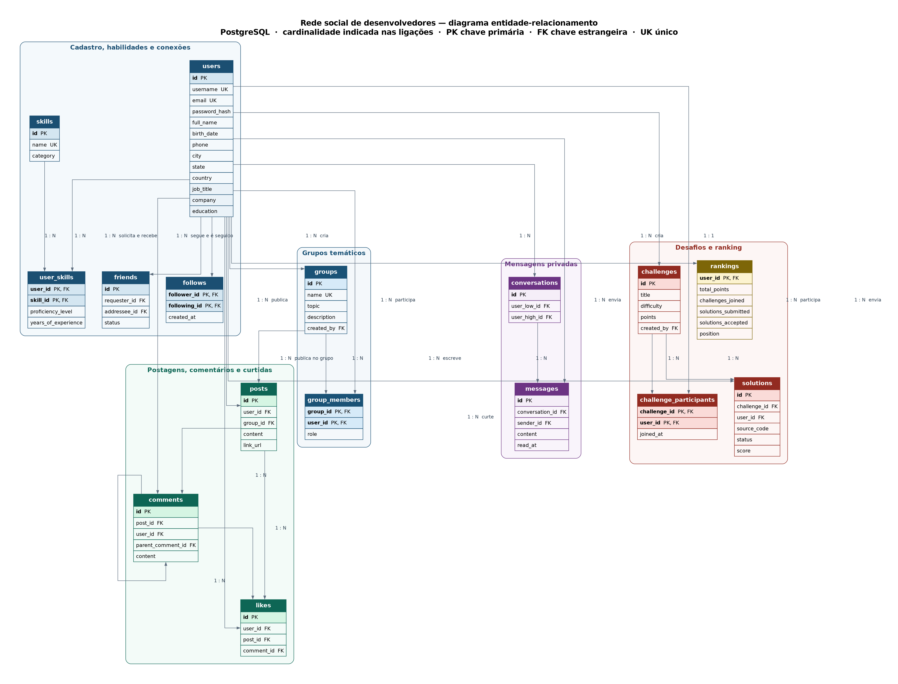

# Rede social — banco de dados

Modelagem relacional de uma rede social para desenvolvedores. O banco guarda o cadastro pessoal e profissional, as postagens, as interações, as mensagens privadas, os grupos temáticos, os desafios de programação e o ranking.

SGBD: **PostgreSQL 14 ou superior**.

## Diagrama entidade-relacionamento



Clique na imagem para ver o diagrama no tamanho original.

O desenho também está em [docs/diagrama.dbml](docs/diagrama.dbml). Para abrir no [dbdiagram.io](https://dbdiagram.io):

1. Acesse o site e crie um diagrama novo.
2. Use **Import → Import from DBML**.
3. Cole o conteúdo de `docs/diagrama.dbml`.
4. Exporte em PNG ou JPG por **Export → Export as PNG**.

## Requisitos atendidos

| Requisito | Onde foi modelado |
| --- | --- |
| Cadastro com dados pessoais e profissionais | `users` (`birth_date`, `phone`, `city`, `job_title`, `company`, `education`) |
| Postagens com texto e link | `posts.content` e `posts.link_url` |
| Curtir e comentar postagens | `comments` e `likes` |
| Mensagens privadas | `conversations` e `messages` |
| Seguir outros usuários | `follows` e a view `vw_feed_seguindo` |
| Conexões de amizade | `friends` e a view `vw_amizades` |
| Habilidades de programação | `skills` e `user_skills` |
| Grupos sobre linguagens ou tecnologias | `groups.topic` e `group_members` |
| Postagens feitas pelos membros do grupo | `posts.group_id`, restrito a quem está em `group_members` |
| Desafios, participação e soluções | `challenges`, `challenge_participants` e `solutions` |
| Ranking da participação nos desafios | `rankings`, atualizado por trigger, e a view `vw_ranking` |

## Estrutura do repositório

```text
docs/
  diagrama.png      exportação do diagrama ER
  diagrama.dbml     fonte para importar no dbdiagram.io
  diagrama.dot      fonte Graphviz do PNG publicado
sql/
  social_network.sql
README.md
```

## Como criar o banco

No terminal, com o PostgreSQL no ar:

```bash
psql -d postgres -c "CREATE DATABASE social_network WITH ENCODING 'UTF8';"
psql -d social_network -f sql/social_network.sql
```

No DBeaver:

1. Crie um banco chamado `social_network` com encoding UTF-8.
2. Conecte-se a esse banco.
3. Abra `sql/social_network.sql` e execute o script inteiro.

O script pode ser executado de novo. Ele apaga as tabelas do esquema e as recria.

## Decisões de modelagem

`friends` e `follows` são relações diferentes. A amizade é um pedido entre duas pessoas e tem status (`pendente`, `aceita`, `recusada`, `bloqueada`). O seguidor é uma relação unilateral: a pessoa passa a ver as postagens de perfil de quem ela segue.

A postagem de perfil e a postagem de grupo usam a mesma tabela `posts`. Quando `group_id` é nulo, a postagem fica no perfil. Quando está preenchido, ela pertence ao grupo. Uma trigger só deixa publicar quem é membro.

A curtida fica em uma única tabela `likes` e aponta para uma postagem ou para um comentário, nunca para os dois. Um índice único impede a mesma pessoa de curtir o mesmo alvo duas vezes.

A conversa privada é única para cada par de usuários. `user_low_id` guarda o menor identificador e `user_high_id` o maior. Uma trigger impede mensagem de quem não faz parte da conversa.

O ranking é armazenado na tabela `rankings` e recalculado sozinho quando um usuário entra, quando alguém se inscreve em um desafio ou quando uma solução muda. A pontuação é:

- 10 pontos por desafio em que a pessoa participou
- 5 pontos por solução enviada
- a soma das notas das soluções aceitas

O desempate usa a quantidade de soluções aceitas, depois a quantidade de participações. A view `vw_ranking` junta essa tabela com o nome do usuário. Para listar a classificação:

```sql
SELECT * FROM vw_ranking ORDER BY position;
```

## Regras garantidas pelo banco

- Usuário não segue a si mesmo e não pede amizade a si mesmo.
- Só existe uma relação de amizade entre o mesmo par, em qualquer direção.
- Postagem precisa de texto. O link, quando existe, começa com `http://` ou `https://`.
- A resposta de um comentário precisa ser da mesma postagem.
- Só o membro publica no grupo.
- Só o participante envia solução. Solução aceita sem nota recebe os pontos do desafio.
- O remetente da mensagem precisa ser um dos dois usuários da conversa.
- Excluir um usuário remove o conteúdo ligado a ele. Grupo e desafio criados por essa pessoa permanecem, com `created_by` nulo.

## Exemplo de uso

Os identificadores abaixo consideram um banco recém-criado, em que a primeira sequência começa em 1.

```sql
INSERT INTO users (username, email, password_hash, full_name, birth_date, city, job_title, company, education)
VALUES
    ('ana', 'ana@email.com', 'hash_ana', 'Ana Souza', '1998-04-12', 'Recife', 'Desenvolvedora Backend', 'Empresa X', 'Ciência da Computação'),
    ('bruno', 'bruno@email.com', 'hash_bruno', 'Bruno Lima', '1996-11-02', 'Olinda', 'Engenheiro de Dados', 'Empresa Y', 'Sistemas de Informação');

INSERT INTO follows (follower_id, following_id) VALUES (1, 2);

INSERT INTO friends (requester_id, addressee_id, status) VALUES (1, 2, 'aceita');

INSERT INTO posts (user_id, content, link_url)
VALUES (2, 'Publiquei um artigo sobre índices no PostgreSQL.', 'https://exemplo.dev/indices');

INSERT INTO comments (post_id, user_id, content)
VALUES (1, 1, 'Texto claro. O exemplo de índice parcial ajudou.');

INSERT INTO likes (user_id, post_id) VALUES (1, 1);
INSERT INTO likes (user_id, comment_id) VALUES (2, 1);

INSERT INTO conversations (user_low_id, user_high_id)
VALUES (LEAST(1, 2), GREATEST(1, 2));

INSERT INTO messages (conversation_id, sender_id, content)
VALUES (1, 1, 'Vamos fazer o desafio de SQL juntos?');

INSERT INTO skills (name, category) VALUES ('PostgreSQL', 'banco_de_dados');
INSERT INTO user_skills (user_id, skill_id, proficiency_level, years_of_experience)
VALUES (1, 1, 'avancado', 3);

INSERT INTO groups (name, topic, description, created_by)
VALUES ('PostgreSQL na prática', 'PostgreSQL', 'Grupo sobre modelagem e SQL.', 1);

INSERT INTO group_members (group_id, user_id, role) VALUES (1, 1, 'admin');

INSERT INTO posts (user_id, group_id, content)
VALUES (1, 1, 'Alguém já usou RANK() para montar um ranking?');

INSERT INTO challenges (title, description, statement, difficulty, points, created_by)
VALUES (
    'Ranking com window function',
    'Calcule a posição dos participantes.',
    'Escreva uma consulta com RANK() ordenando pela pontuação.',
    'medio',
    100,
    1
);

INSERT INTO challenge_participants (challenge_id, user_id) VALUES (1, 1);

INSERT INTO solutions (challenge_id, user_id, source_code, language, status)
VALUES (1, 1, 'SELECT RANK() OVER (ORDER BY total_points DESC) FROM rankings;', 'sql', 'aceita');

SELECT * FROM vw_ranking ORDER BY position;
```

Depois da solução aceita, a Ana fica com 115 pontos: 10 pela participação, 5 pelo envio e 100 pelo desafio.

## Contribuidores

- [Lucas Raphael](https://github.com/LucasRaphael3)
- [Izabelle Luna](https://github.com/zabeluna)
- [Joseph Cavalcante](https://github.com/usrJosephC)
- [Anthony Gabriel](https://github.com/AnthonyGabrielAA)
